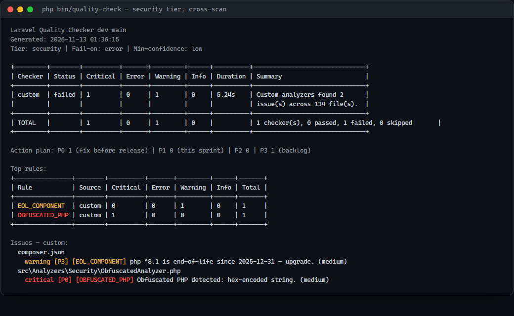

---
layout: default
title: Rampart Quality Checker — Tiếng Việt
description: Tài liệu tiếng Việt cho quality gate Laravel.
---

# Rampart Quality Checker — Tiếng Việt

[English]({{ site.baseurl }}/en/) · [日本語]({{ site.baseurl }}/ja/) · [Tiếng Việt]({{ site.baseurl }}/vi/)

Quality gate toàn diện cho **Laravel 9–13** trên **PHP 8.1+**. Một lệnh Artisan
chạy toàn bộ pipeline và trả exit code chuẩn cho CI.



## Hệ sinh thái Rampart

| Dự án | Phạm vi | Repository | Tài liệu |
|---|---|---|---|
| **Rampart** | Quality gate Laravel (Artisan) | [GitHub](https://github.com/thiennhant95/Rampart) | [Pages](https://thiennhant95.github.io/Rampart/) |
| **Rampart PHP** | PHP thuần + đa framework, PHP 7.4+ | [GitHub](https://github.com/thiennhant95/Rampart-PHP) | [Pages](https://thiennhant95.github.io/Rampart-PHP/) |
| **Rampart WP** | Plugin/theme WordPress | [GitHub](https://github.com/thiennhant95/Rampart-Wordpress) | [Pages](https://thiennhant95.github.io/Rampart-Wordpress/) |

## Cài đặt

```bash
composer require rampart/quality-checker --dev
php artisan vendor:publish --tag=quality-checker-config
```

Service provider được auto-discover. Publish config là tùy chọn, nên làm khi cần
đổi paths, tier, tool hoặc bật Trivy.

## Chạy nhanh

```bash
# Lần chạy an toàn đầu tiên
php artisan quality:check --tier=security --only=custom,composer_audit

# Full gate
php artisan quality:check

# Tất cả báo cáo
php artisan quality:check --format=all --output=reports/quality-checker
```

Exit code: `0` pass · `1` vượt ngưỡng · `2` sai tham số · `3` lỗi nội bộ.

## Kiểm tra gì

- **Tool wrap:** phpcs (PSR-12), phpstan (level 6 mặc định), phpunit (JUnit +
  Clover coverage), composer audit, npm audit, trivy tùy chọn.
- **OWASP Top 10 2021:** broken access control, IDOR, path traversal, Blade XSS,
  SSTI, command injection, misconfiguration, XXE, open redirect, SSRF.
- **Bảo mật:** SQLi, eval, hardcoded secret, mass assignment, deserialize,
  hash/cookie/session/password yếu, CSRF, taint engine (tùy chọn).
- **Laravel:** migration có thể rollback, `up()` phá hoại, route validation.
- **Test:** thiếu test controller/service/repository/model/unit/feature, test
  không có assertion (tùy chọn).
- **Frontend:** cú pháp JS/CSS, Blade `@push`/`@stack`.
- **Ops/forensics:** quyền file, EOL, PHP lạ trong `public/`, PHP obfuscated.
- **Convention (tùy chọn):** dead code, naming, TODO/FIXME, `env()`, `dd()`,
  `sleep()` trong test.

Bảng đầy đủ: [README](https://github.com/thiennhant95/Rampart#custom-analyzer-rules)

## Báo cáo

`console` / `json` / `html` / `md` / `sarif`. HTML self-contained, có search,
dark mode, fix guidance, code snippet, chart severity/top rule, OWASP drill-down
và action plan.

3 biến thể HTML: `quality-report.html` (developer),
`quality-report-findings.html` (`--no-remediation`),
`quality-report-client.html` (`--client`).

## CI

```yaml
- run: composer install --prefer-dist --no-progress
- run: php artisan quality:check --ci
```

Dùng `--format=sarif` để đẩy lên GitHub code scanning. Nếu cài `--no-dev`, thêm
`--only=custom`.

## Baseline

```bash
php artisan quality:check --format=all --fail-on=none
php artisan quality:check --baseline-generate
php artisan quality:check --ci --baseline-file=baseline.json
```

Sau đó chỉ finding mới làm fail. Suppression inline:
`// quality-checker-ignore RULE` hoặc
`// quality-checker-ignore-next-line RULE`.

## Nâng cấp

Đọc [UPGRADE.md](https://github.com/thiennhant95/Rampart/blob/main/UPGRADE.md)
trước khi re-baseline. Lịch sử đầy đủ ở
[CHANGELOG](https://github.com/thiennhant95/Rampart/blob/main/CHANGELOG.md).

## Tài liệu

- [Tổng quan]({{ site.baseurl }}/overview.html)
- [Báo cáo]({{ site.baseurl }}/reports.html) · [Client report]({{ site.baseurl }}/client-reports.html)
- [Baseline]({{ site.baseurl }}/baseline.html)
- [False positive]({{ site.baseurl }}/false-positives.html)
- [So sánh với Enlightn]({{ site.baseurl }}/comparison-enlightn.html)

## Giấy phép

MIT © 2026 Rampart.
